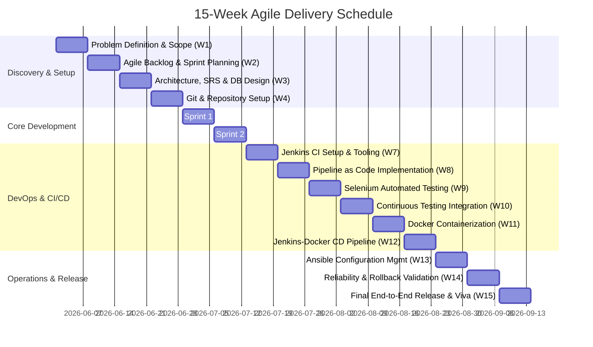
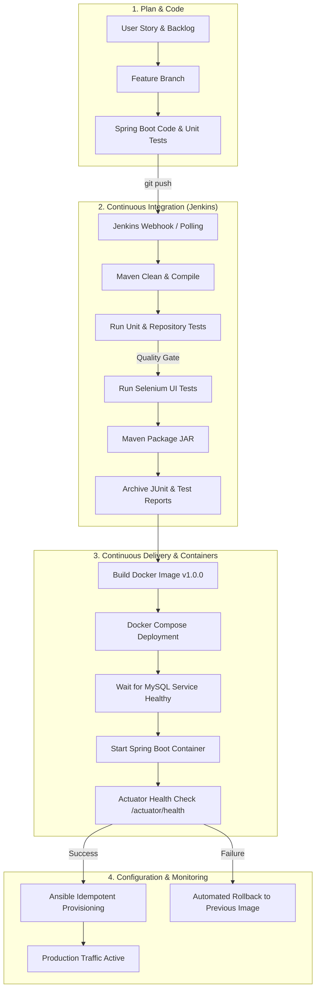

# Week 2: Agile Planning and DevOps Workflow

**Project:** Automated Residential Visitor Gate-Pass System  
**Document Code:** DOC-W02-APW  
**Version:** 1.0.0  
**Date:** October 14, 2026  

---

## 1. Agile Framework & Sprint Architecture

The development followed an Agile Scrum methodology organized across **five 2-week development sprints** followed by **hardening and DevOps delivery sprints** within a 15-week academic calendar:

---

## 2. Core User Stories & Acceptance Criteria

### US-01: Guard Visitor Registration
- **As a** Security Guard at the front gate,  
  **I want to** register an arriving visitor by capturing their name, phone number, vehicle number, purpose, and destination resident,  
  **So that** a digital gate-pass is created and sent for resident approval.  
- **Acceptance Criteria:**
  - *Given* the guard is logged into the gate kiosk,
  - *When* valid visitor details and host resident are submitted,
  - *Then* a pass record with unique pass code (`GP-XXXX`) is persisted in `PENDING` status and a success notification is displayed.

### US-02: Resident Pass Approval & Rejection
- **As a** Resident Host,  
  **I want to** review pending gate-pass requests destined for my residence,  
  **So that** I can approve legitimate guests and reject unknown visitors.  
- **Acceptance Criteria:**
  - *Given* a visitor pass is in `PENDING` status for the logged-in resident's apartment,
  - *When* the resident clicks "Approve", the pass transitions to `APPROVED`.
  - *When* the resident clicks "Reject", the pass transitions to `REJECTED`.
  - *Given* a pass is for another apartment, *Then* the resident is unauthorized to modify it.

### US-03: Resident Pre-Registration
- **As a** Resident Host,  
  **I want to** pre-register an expected guest in advance,  
  **So that** they receive a pre-approved pass and experience zero delay at the gate.  
- **Acceptance Criteria:**
  - *Given* the resident submits their guest details via the portal,
  - *Then* the pass is directly created in `APPROVED` status with host set to the current resident.

### US-04: Guard Check-In and Check-Out
- **As a** Security Guard,  
  **I want to** record entry and exit times of approved visitors,  
  **So that** the society maintains an accurate real-time headcount of visitors inside the premises.  
- **Acceptance Criteria:**
  - *Given* a pass is `APPROVED`, clicking "Check-In" records the current timestamp and sets status to `CHECKED_IN`.
  - *Given* a pass is `CHECKED_IN`, clicking "Check-Out" records the exit timestamp and sets status to `CHECKED_OUT`.
  - *Given* a pass is `PENDING` or `REJECTED`, check-in is rejected by the server.

### US-05: Real-Time Operational Dashboard
- **As an** Administrator or Security Guard,  
  **I want to** view live metric counters for Total, Pending, Approved, Inside, and Checked Out passes,  
  **So that** I have immediate visibility over active facility traffic.

### US-06: Search & Historical Record Retrieval
- **As an** Administrator,  
  **I want to** search records by visitor name, phone number, pass code, vehicle, or date,  
  **So that** I can perform security audits and answer resident queries instantly.

---

## 3. Definition of Ready (DoR) and Definition of Done (DoD)

### Definition of Ready (DoR)
1. User story contains a clear persona, action, and business justification.
2. Acceptance criteria written in unambiguous Gherkin/testable format.
3. Database schema impacts and API contracts identified.
4. Security/authorization roles defined.
5. Story pointed and prioritized in product backlog.

### Definition of Done (DoD)
1. Code implemented and conforming to clean architecture standards.
2. Server-side validation and state machine constraints enforced.
3. Automated unit and integration tests passing in Maven (`mvn test`).
4. End-to-end user journeys verified via Selenium WebDriver.
5. Code committed to Git with conventional commit messages.
6. Jenkins pipeline stage executed with zero errors.
7. Docker container builds and passes container health checks.
8. Relevant documentation updated in `docs/`.

---

## 4. End-to-End DevOps Lifecycle Workflow

