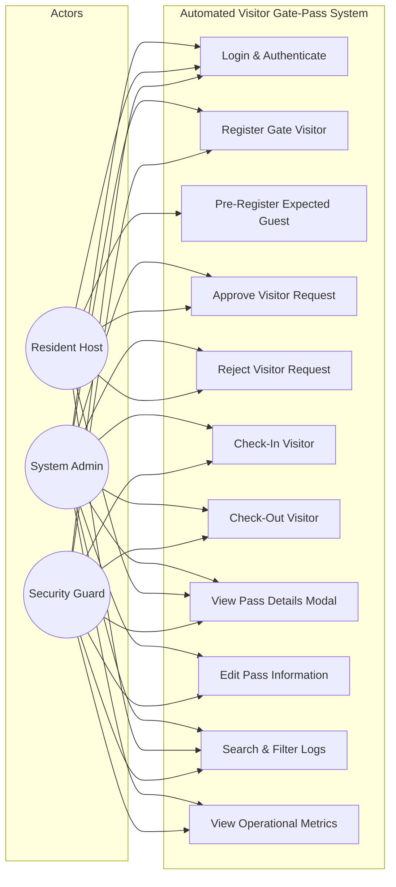
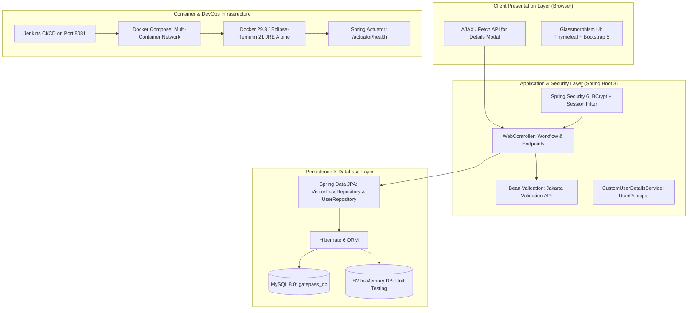
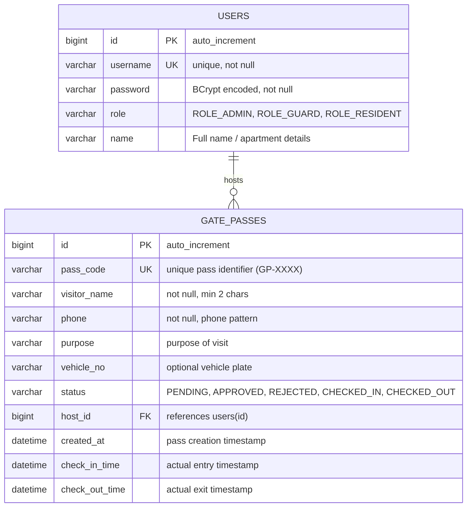

# Week 3: Requirements, Architecture, and Technology Setup

**Project:** Automated Residential Visitor Gate-Pass System  
**Document Code:** DOC-W03-RAT  
**Version:** 1.0.0  
**Date:** October 14, 2026  

---

## 1. Software Requirements Specification (SRS)

### 1.1 Functional Requirements (FR)
- **FR-01: Authentication:** Secure username/password login with BCrypt password encryption and Spring Security session protection.
- **FR-02: Role Enforcement:** Hierarchical roles (`ROLE_ADMIN`, `ROLE_GUARD`, `ROLE_RESIDENT`) enforced server-side.
- **FR-03: Pass Generation:** Guards create passes in `PENDING` status; residents pre-register guests in `APPROVED` status.
- **FR-04: Workflow Enforcement:** State machine transitions:
  - `PENDING → APPROVED` (Resident or Admin only)
  - `PENDING → REJECTED` (Resident or Admin only)
  - `APPROVED → CHECKED_IN` (Guard or Admin only; sets `checkInTime`)
  - `CHECKED_IN → CHECKED_OUT` (Guard or Admin only; sets `checkOutTime`)
- **FR-05: Record Editing:** Allows modification of visitor details for passes not yet checked in.
- **FR-06: Metrics Dashboard:** Dynamic counters for Total, Pending, Approved, Inside, Checked Out, and Rejected.
- **FR-07: Search & Filtering:** In-memory and SQL-backed multi-field queries and quick status filter pills.
- **FR-08: Details Modal:** REST endpoint `/api/passes/{id}` supplying JSON attributes for UI modal viewing.

### 1.2 Non-Functional Requirements (NFR)
- **NFR-01: Response Time:** Page transitions and API responses `< 500 ms` under standard local network conditions.
- **NFR-02: Security:** CSRF awareness, BCrypt hashing (10 salt rounds), parameterized JPA queries preventing SQL injection.
- **NFR-03: Reliability:** Container auto-restart policy (`restart: on-failure`) and MySQL readiness gating (`service_healthy`).
- **NFR-04: Observability:** Spring Boot Actuator exposing `/actuator/health` for automated CI/CD and container health checks.
- **NFR-05: Portability:** Containerized Docker runtime ensuring identical behavior across Windows, Linux, and cloud environments.

---

## 2. Mermaid Use-Case Diagram



---

## 3. System Architecture Diagram



---

## 4. Database Schema & Entity-Relationship (ER) Diagram



### Schema DDL (MySQL 8)
```sql
CREATE DATABASE IF NOT EXISTS gatepass_db;
USE gatepass_db;

CREATE TABLE IF NOT EXISTS users (
    id BIGINT NOT NULL AUTO_INCREMENT,
    username VARCHAR(255) NOT NULL UNIQUE,
    password VARCHAR(255) NOT NULL,
    role VARCHAR(50) NOT NULL,
    name VARCHAR(255) NOT NULL,
    PRIMARY KEY (id)
) ENGINE=InnoDB DEFAULT CHARSET=utf8mb4;

CREATE TABLE IF NOT EXISTS gate_passes (
    id BIGINT NOT NULL AUTO_INCREMENT,
    pass_code VARCHAR(50) UNIQUE,
    visitor_name VARCHAR(100) NOT NULL,
    phone VARCHAR(50) NOT NULL,
    purpose VARCHAR(255),
    vehicle_no VARCHAR(50),
    status VARCHAR(50) NOT NULL,
    host_id BIGINT NOT NULL,
    created_at DATETIME(6),
    check_in_time DATETIME(6),
    check_out_time DATETIME(6),
    PRIMARY KEY (id),
    CONSTRAINT fk_gate_pass_host FOREIGN KEY (host_id) REFERENCES users(id) ON DELETE CASCADE
) ENGINE=InnoDB DEFAULT CHARSET=utf8mb4;
```

---

## 5. REST & Web API Endpoint Specification

| Method | Endpoint | Allowed Roles | Description | Request Parameters / Body | Response |
|:---:|:---|:---:|:---|:---|:---|
| `GET` | `/login` | Public | Render authentication page | None | `200 OK` (login.html) |
| `POST` | `/login` | Public | Form login submission | `username`, `password` | `302 Redirect` to `/dashboard` |
| `POST` | `/logout` | Authenticated | Terminate session | None | `302 Redirect` to `/login?logout` |
| `GET` | `/dashboard` | Authenticated | Main role-aware dashboard | `statusFilter`, `query` | `200 OK` (dashboard.html) |
| `POST` | `/guard/create-pass` | GUARD, ADMIN | Create gate pass at kiosk | `visitorName`, `phone`, `purpose`, `vehicleNo`, `hostId` | `302 Redirect` to `/dashboard` |
| `POST` | `/resident/pre-register` | RESIDENT | Pre-register expected guest | `visitorName`, `phone`, `purpose`, `vehicleNo` | `302 Redirect` to `/dashboard` |
| `POST` | `/resident/update-status/{id}` | RESIDENT, ADMIN | Approve or reject pass | `status` (`APPROVED`/`REJECTED`) | `302 Redirect` to `/dashboard` |
| `POST` | `/guard/update-status/{id}` | GUARD, ADMIN | Check in / check out visitor | `status` (`CHECKED_IN`/`CHECKED_OUT`) | `302 Redirect` to `/dashboard` |
| `POST` | `/pass/edit/{id}` | GUARD, ADMIN | Update visitor pass details | `visitorName`, `phone`, `purpose`, `vehicleNo` | `302 Redirect` to `/dashboard` |
| `GET` | `/api/passes/{id}` | Authenticated | Fetch JSON pass details | `id` in path | `200 OK` (JSON payload) |
| `GET` | `/actuator/health` | Public | Liveness / readiness check | None | `200 OK` (`{"status":"UP"}`) |

---

## 6. Role & Permission Matrix

| Capability / Action | Anonymous | Guard (`ROLE_GUARD`) | Resident (`ROLE_RESIDENT`) | Admin (`ROLE_ADMIN`) |
|:---|:---:|:---:|:---:|:---:|
| Access Login Page | Yes | Yes | Yes | Yes |
| View System Dashboard | No | Yes (All passes) | Yes (Own passes only) | Yes (All passes) |
| View Metric Counters | No | Yes | Yes (Scoped) | Yes |
| Register Walk-in Visitor | No | Yes | No | Yes |
| Pre-Register Guest | No | No | Yes (Auto-approved) | Yes |
| Approve/Reject Pending Pass | No | No | Yes (Own residence only) | Yes |
| Check-In Approved Visitor | No | Yes | No | Yes |
| Check-Out Active Visitor | No | Yes | No | Yes |
| Edit Visitor Details | No | Yes (If not checked-in) | Yes (Own host only) | Yes |
| Search All Records | No | Yes | Yes (Scoped to host) | Yes |

---

## 7. Technology Selection Justification

1. **Backend Framework: Spring Boot 3.2.4 (Java 21 LTS)**
   - Industry-standard enterprise grade framework providing built-in security, JPA persistence, Actuator health endpoints, and embedded Tomcat.
2. **Template Engine: Thymeleaf**
   - Natural server-side HTML5 templating that integrates seamlessly with Spring Security tags, reducing frontend build toolchain overhead while enabling responsive, glassmorphic UI.
3. **Database: MySQL 8.0 & H2 In-Memory**
   - MySQL 8.0 provides production ACID-compliant relational storage with foreign key constraints. H2 provides zero-setup, lightning-fast in-memory execution for isolated automated testing.
4. **Testing Suite: JUnit 5, MockMvc & Selenium WebDriver 4.19.1**
   - Complete multi-tier testing: MockMvc for fast controller slice testing; DataJpaTest for repository queries; Selenium with headless Chrome for authentic browser user journeys.
5. **Containerization: Docker & Docker Compose**
   - Decoupled microservices architecture (`app` and `db`) with custom network bridges, volume persistence, and database health check dependencies.
6. **Continuous Integration: Jenkins 2.x**
   - Automated Declarative Pipeline as Code (`Jenkinsfile`) running on port 8081 with automated quality gates and container redeployment.
7. **Configuration Management: Ansible**
   - Agentless, YAML-based idempotent infrastructure automation supporting reproducible multi-environment configuration and rollback.
