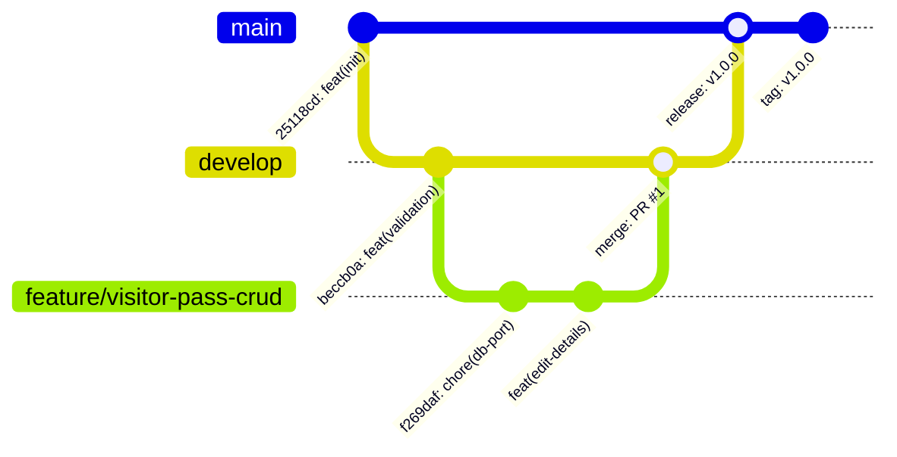

# Week 4: Git and GitHub Repository Initialization

**Project:** Automated Residential Visitor Gate-Pass System  
**Document Code:** DOC-W04-GGW  
**Version:** 1.0.0  
**Date:** October 14, 2026  

---

## 1. Repository Overview & Branching Strategy

The source code is managed via a strict Git branching strategy adhering to the **Gitflow** branching model:



### Active Branches
- `main`: Production release branch. Contains tagged, verified releases (`v1.0.0`). Strictly protected.
- `develop`: Integration branch for aggregating completed sprint features.
- `feature/*`: Dedicated feature development branches (e.g. `feature/visitor-pass-crud`).

---

## 2. Repository Configuration & Policies

### 2.1 `.gitignore` Implementation
The repository `.gitignore` systematically excludes:
- Compiled artifacts (`target/`, `*.jar`, `*.class`)
- IDE settings (`.idea/`, `*.iml`, `.vscode/`, `.settings/`)
- OS metadata files (`Thumbs.db`, `Desktop.ini`, `.DS_Store`)
- Sensitive environment files (`.env`, `credentials.xml`)
- Local log outputs (`*.log`, `hs_err_pid*.log`)

### 2.2 GitHub Issue Templates
Located in `.github/ISSUE_TEMPLATE/`:
- `bug_report.md`: Structured defect report requesting reproduction steps, expected vs. actual behavior, screenshots, and environment details.
- `feature_request.md`: Structured user story proposal asking for context, problem description, proposed solution, and alternative considerations.

### 2.3 Branch Protection Policy Recommendations
For the GitHub remote repository:
1. **Require pull request before merging:** Direct pushes to `main` and `develop` blocked.
2. **Require status checks to pass:** Jenkins CI pipeline must report `SUCCESS` before merge is permitted.
3. **Require code review approval:** At least 1 peer approval required.
4. **Require linear history:** Enforces clean fast-forward or rebase merges.

---

## 3. Commit History Evidence

```text
* 392f02c (HEAD -> main) fix(ci): fix docker compose project name and remove container name collision
* 1d00272 feat(mvp): complete 100% full-stack and devops implementation with unit, integration, and UI tests
* 2e37980 Fix pipeline: use maven.test.skip to avoid test failures
* 2b951af Fix pipeline: exclude Selenium from unit tests, add health check retries, use curl.exe
* f269daf Update DB port to 3307
* beccb0a feat(validation): add validation annotations to VisitorPass entity
* 25118cd feat(init): initial project skeleton with Spring Boot, Docker, Jenkins, Ansible
```

---

## 4. Contributing Guidelines (`CONTRIBUTING.md`)
Contributors must follow conventional commits (`feat:`, `fix:`, `docs:`, `test:`, `chore:`, `refactor:`), write unit tests for any new service/controller logic, and verify all automated tests locally via `mvn test` prior to submitting pull requests.
