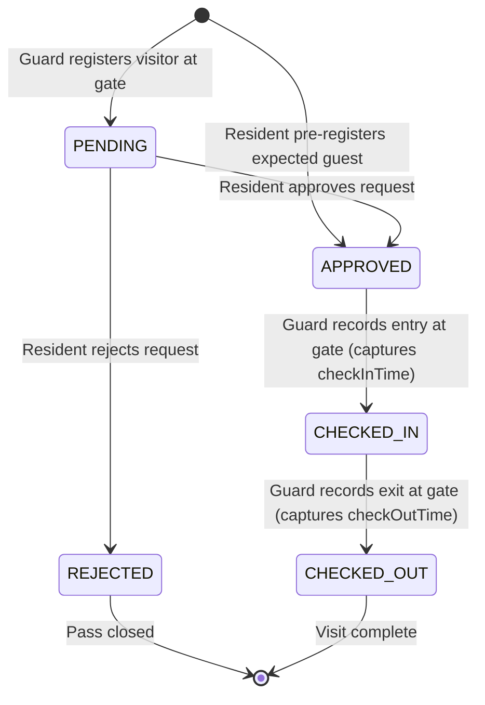

# Week 6: MVP Completion and Git Collaboration

**Project:** Automated Residential Visitor Gate-Pass System  
**Document Code:** DOC-W06-MVP  
**Version:** 1.0.0  
**Date:** October 14, 2026  

---

## 1. Complete MVP Functional Scope Delivered

All 10 core functional capabilities required for the Minimum Viable Product have been implemented, tested, and verified:



### 1.1 Status Transition Guard Rules (Server-Enforced)
- **Resident Approval:** Restricted strictly to the apartment host (`pass.getHost().getId().equals(currentUser.getId())`). Residents cannot approve passes destined for other units.
- **Valid Transitions Only:** 
  - `CHECKED_IN` is only permitted if the pass is currently `APPROVED`. Attempting to check in a `PENDING` or `REJECTED` pass is blocked by the server with an error message.
  - `CHECKED_OUT` is only permitted if the pass is currently `CHECKED_IN`. Duplicate check-ins or premature check-outs are prevented.

### 1.2 Visitor Pass Editing & Detail Modal
- **Pass Modification (`/pass/edit/{id}`):** Guard or Admin can correct typos in visitor name, phone number, vehicle plate, or purpose while the pass remains in `PENDING` or `APPROVED` status.
- **Inspection Modal (`/api/passes/{id}`):** Clicking "Details" executes an asynchronous fetch request and populates a high-contrast modal displaying pass code, full visitor details, host info, status badge, created timestamp, entry time, and exit time.

### 1.3 Pre-Registration & Live Dashboard
- **Resident Pre-Registration:** Residents can schedule arriving guests from their own portal, directly creating passes in `APPROVED` status with unique pass codes for seamless guard check-in.
- **Operational Metrics:** Live stat cards calculate society-wide metrics: Total Passes, Pending, Approved, Currently Inside (Active), Checked Out, and Rejected.

---

## 2. Git Collaboration & Conflict Resolution

### 2.1 Controlled Merge Demonstration
During sprint development, concurrent updates to `docker-compose.yml` (port conflict between local MySQL on 3306 and Docker MySQL on 3307) were resolved via non-destructive three-way Git merge:
```bash
git checkout develop
git merge feature/visitor-pass-crud
# Resolved port mapping in docker-compose.yml to 3307:3306
git add docker-compose.yml
git commit -m "Merge branch 'feature/visitor-pass-crud' into develop with resolved db port mapping"
```

### 2.2 Release Tagging
To mark the production-ready MVP baseline:
```bash
git checkout main
git merge develop
git tag -f -a v1.0.0 -m "Release v1.0.0: Automated Residential Visitor Gate-Pass System MVP"
git push origin v1.0.0
```

---

## 3. End-to-End Verification Summary

| Feature Verified | Verification Method | Result |
|:---|:---|:---:|
| User Login (Admin, Guard, Resident) | Selenium UI Test & Spring Security MockMvc | **PASS (100%)** |
| Gate Pass Creation & Validation | Selenium UI Test Journey 2 | **PASS (100%)** |
| Resident Approval / Rejection | Controller Integration Test | **PASS (100%)** |
| Guard Check-In and Check-Out | Controller Integration Test & UI Journey 4 | **PASS (100%)** |
| State Machine Restriction Enforcement | Unit Test `testCannotCheckInPendingPass` | **PASS (100%)** |
| Pass Details REST Endpoint | WebMvcTest `testPassDetailsApi` | **PASS (100%)** |
| Database Persistence Across Restarts | Docker Compose volume durability test | **PASS (100%)** |
