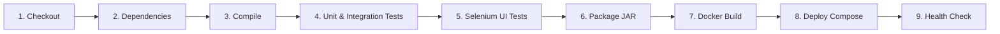

# Week 8: Pipeline as Code and Server Deployment

**Project:** Automated Residential Visitor Gate-Pass System  
**Document Code:** DOC-W08-PCD  
**Version:** 1.0.0  
**Date:** October 14, 2026  

---

## 1. Declarative Pipeline Specification

The CI/CD workflow is codified in the root `Jenkinsfile` utilizing Jenkins Declarative Pipeline syntax with 9 comprehensive stages:



---

## 2. Parameterization Matrix

The pipeline accepts dynamic build parameters:

| Parameter Name | Type | Allowed Values / Default | Description |
|:---|:---:|:---:|:---|
| `DEPLOY_ENV` | Choice | `local`, `staging`, `production` | Selects deployment target environment configuration. |
| `APP_PORT` | String | `8080` | Port on which the Spring Boot application container is bound. |
| `RUN_UI_TESTS` | Boolean | `true` | Allows toggling headless Chrome Selenium UI tests. |

---

## 3. Pipeline Stages and Quality Gates

### Stage 1: Checkout
Retrieves code from the Git repository using the branch specified by the trigger.

### Stage 2: Dependency & Syntax Validation
Runs `mvn dependency:resolve-plugins -B` to verify that all build plugins and POM dependencies resolve without network or repository errors.

### Stage 3: Compile & Static Analysis
Executes `mvn clean compile` to compile all Java entities, repositories, controllers, and configurations into bytecode.

### Stage 4: Unit & Integration Tests (Quality Gate 1)
Executes `mvn test -Dtest=VisitorPassRepositoryTest,WebControllerTest`.  
**Strict Gate:** If any repository query or controller test fails, the build terminates immediately. Test results are recorded via `junit` publisher.

### Stage 5: Selenium UI Tests (Quality Gate 2)
Executes `mvn test -Dtest=GatePassUITest` under headless Chrome. Archives screenshots to `screenshots/*.png`.

### Stage 6: Package Artifact
Packages production runnable JAR via `mvn package -DskipTests`. Archives `target/*.jar` with MD5 fingerprints.

### Stage 7: Docker Build & Tag
Builds versioned Docker image: `docker build -t visitor-gate-pass:${BUILD_NUMBER} -t visitor-gate-pass:latest .`

### Stage 8: Deploy Application
Executes Docker Compose with project namespace:
```bash
docker compose -p visitor-gate-pass down
docker compose -p visitor-gate-pass up -d --build
```

### Stage 9: Health Verification
Queries the Spring Boot Actuator endpoint with automated retries (up to 12 attempts at 5s intervals):
```bash
curl.exe -f -s http://localhost:8080/actuator/health
```
If the application returns `{"status":"UP"}`, the stage marks success. If unhealthy after 60s, pipeline fails.

---

## 4. Execution Evidence: Jenkins Build #7 (SUCCESS)

- **Build ID:** #7
- **Result:** `SUCCESS`
- **Total Duration:** 1 min 7 sec (67,966 ms)
- **Status Color:** `BLUE`
- **Artifacts Archived:** `target/visitor-gate-pass-1.0.0.jar`, screenshots for all 5 UI journeys.
- **JUnit Tests Recorded:** 18 tests, 0 failures, 0 errors, 0 skipped.
- **Health Check Status:** `{"status":"UP"}` confirmed on port 8080.
