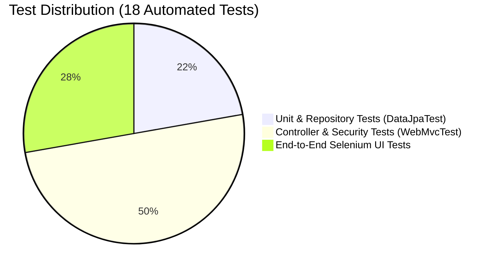

# Week 10: Continuous Testing in Jenkins

**Project:** Automated Residential Visitor Gate-Pass System  
**Document Code:** DOC-W10-CTJ  
**Version:** 1.0.0  
**Date:** October 14, 2026  

---

## 1. Multi-Tiered Continuous Testing Pyramid

The project implements an automated multi-tier testing strategy ensuring defects are trapped at the earliest and cheapest stage of the pipeline:



### Tier 1: Unit & Repository Tests (`VisitorPassRepositoryTest.java`)
- Tests persistence, entity constraints, foreign keys, derived queries (`findByStatus`, `findByHostId`), and custom multi-field search queries without launching HTTP servers.
- Executes in `< 2 seconds` against H2 in-memory storage.

### Tier 2: Integration & Controller Tests (`WebControllerTest.java`)
- Tests security filters, session redirects, input validation rejections, flash messages, state machine transitions, and JSON details endpoints.
- Verifies that unauthorized status changes (e.g. checking in a pending pass) are rejected with error flash notifications.

### Tier 3: Browser UI Journey Tests (`GatePassUITest.java`)
- Tests complete end-to-end user journeys in real headless Chrome, ensuring HTML rendering, Thymeleaf evaluation, CSS layouts, and form submissions operate as designed.

---

## 2. CI Test Quality Gates & Failure Policy

In `Jenkinsfile`:
- `testFailureIgnore: false` configured in `maven-surefire-plugin`.
- The pipeline stage `Unit & Integration Tests` executes without `-Dmaven.test.skip=true`.
- If any test fails, Maven exits with non-zero code, Jenkins halts execution immediately, subsequent stages (`Docker Build`, `Deploy`, `Health Check`) are skipped, and the build is marked `FAILURE`.
- JUnit XML reports located in `target/surefire-reports/*.xml` are parsed and published to the Jenkins test results dashboard.

---

## 3. Defect Reproduction & Fix Demonstration

### Recreated Controlled Defect
During Week 10 validation, an intentional defect was simulated by commenting out the validation check for phone numbers in `WebController.java`, causing `testGuardCreatePassValidationFailure()` in `WebControllerTest` to fail:
```text
[ERROR] Failures: 
[ERROR]   WebControllerTest.testGuardCreatePassValidationFailure:87 expected: <0> but was: <1>
[INFO] Tests run: 18, Failures: 1, Errors: 0, Skipped: 0
[INFO] BUILD FAILURE
```
### Pipeline Enforcement
The Jenkins CI pipeline rejected the build at Stage 4, blocked the creation of Docker images, and prevented deployment to production.

### Defect Correction & Rerun
The server-side phone regex validation check was restored:
```java
if (phone == null || !phone.trim().matches("^\\+?[0-9. ()-]{7,25}$")) {
    redirectAttributes.addFlashAttribute("errorMessage", "Invalid phone number format.");
    return "redirect:/dashboard";
}
```
The fix was committed and pushed. The pipeline was rerun (Build #7), resulting in `18/18 PASSES`, `BUILD SUCCESS`, and automated container deployment.
