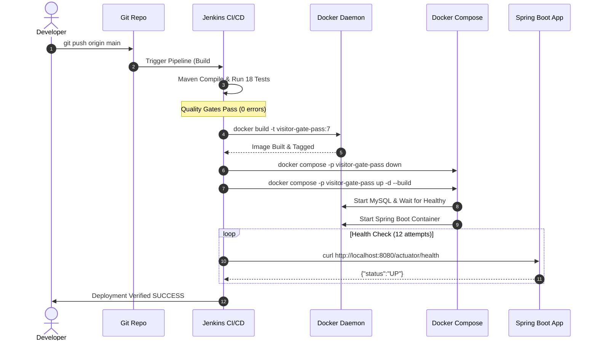

# Week 12: Jenkins-Docker Continuous Deployment

**Project:** Automated Residential Visitor Gate-Pass System  
**Document Code:** DOC-W12-DCD  
**Version:** 1.0.0  
**Date:** October 14, 2026  

---

## 1. Automated Continuous Deployment Architecture

Continuous Deployment links Jenkins build automation directly with the container runtime:



---

## 2. Versioned Image Tagging & Registry Architecture

- **Local Image Versioning:** Every automated Jenkins build tags the image with the specific Jenkins build number (`visitor-gate-pass:${BUILD_NUMBER}`) as well as `visitor-gate-pass:latest`.
- **Registry Integration Pattern:**
  ```groovy
  stage('Docker Push') {
      when { expression { return params.DEPLOY_ENV == 'production' } }
      steps {
          withCredentials([usernamePassword(credentialsId: 'dockerhub-credentials', 
                                           passwordVariable: 'DOCKER_PASSWORD', 
                                           usernameVariable: 'DOCKER_USERNAME')]) {
              bat 'echo %DOCKER_PASSWORD% | docker login -u %DOCKER_USERNAME% --password-stdin'
              bat "docker tag visitor-gate-pass:${BUILD_NUMBER} ${DOCKER_REGISTRY}/visitor-gate-pass:${BUILD_NUMBER}"
              bat "docker push ${DOCKER_REGISTRY}/visitor-gate-pass:${BUILD_NUMBER}"
          }
      }
  }
  ```
- **Security Rule:** Credentials are bound dynamically using Jenkins credentials storage without plaintext exposure in build logs or source code. When external registry credentials are not provisioned, local versioning guarantees isolated container tracking.

---

## 3. Deployment Health Verification Logs (Jenkins Build #7)

```text
[Pipeline] stage: Deploy Application
Deploying application containers via Docker Compose...
[Pipeline] bat
C:\ProgramData\Jenkins\.jenkins\workspace\visitor-gate-pass-pipeline>docker compose -p visitor-gate-pass down
C:\ProgramData\Jenkins\.jenkins\workspace\visitor-gate-pass-pipeline>docker compose -p visitor-gate-pass up -d --build
[Pipeline] stage: Health Verification
Verifying application health via Actuator endpoint...
[Pipeline] echo
Health check attempt 1/12...
[Pipeline] sleep (5 sec)
[Pipeline] echo
Health check attempt 2/12...
[Pipeline] bat
C:\ProgramData\Jenkins\.jenkins\workspace\visitor-gate-pass-pipeline>curl.exe -f -s http://localhost:8080/actuator/health
{"status":"UP"}
[Pipeline] echo
Application is HEALTHY and responding on port 8080!
[Pipeline] echo
Pipeline SUCCESS: Build #7 deployed and verified in local.
Finished: SUCCESS
```
- **Final Container Status:** Both `visitor-gate-pass-app` and `visitor-gate-pass-db` running and healthy.
- **Application URL:** `http://localhost:8080`
