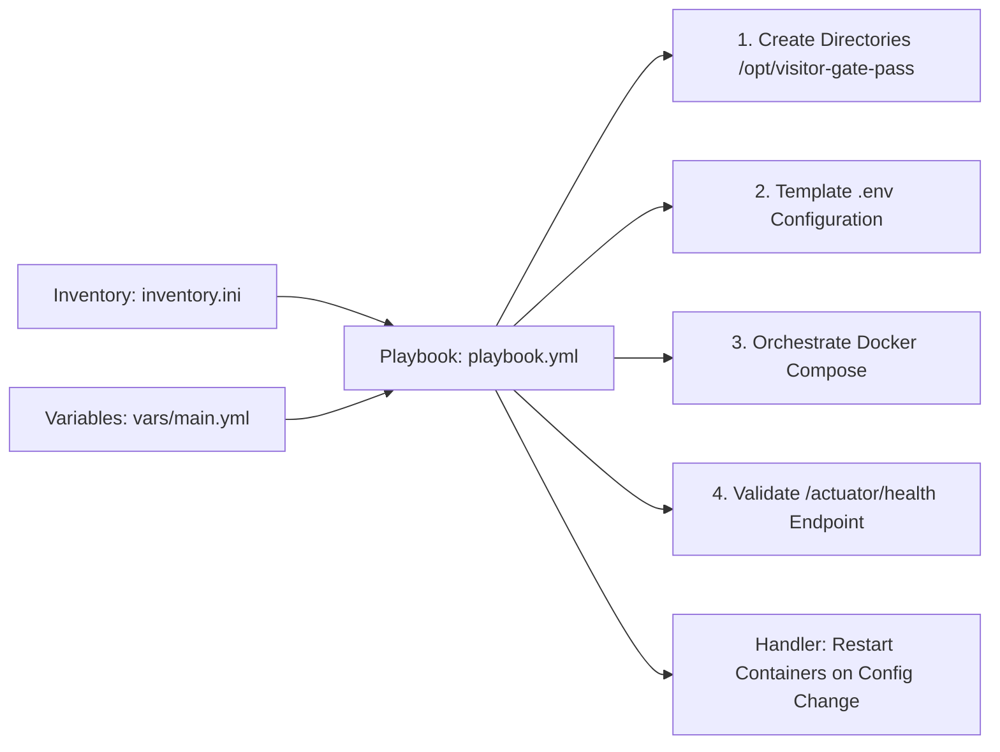

# Week 13: Configuration Management Script

**Project:** Automated Residential Visitor Gate-Pass System  
**Document Code:** DOC-W13-CMS  
**Version:** 1.0.0  
**Date:** October 14, 2026  

---

## 1. Configuration Management Architecture

Configuration management is implemented using **Ansible**, an agentless automation engine executing over SSH or local connection. Ansible standardizes target host provisioning, environment templating, container deployment, and configuration drift prevention.



---

## 2. Inventory and Variable Structure

### Inventory (`ansible/inventory.ini`)
Defines environments (`[local]`, `[staging]`, `[production]`) and variables (`deploy_env`, `app_port`, `db_port`).

### Externalized Variables (`ansible/vars/main.yml`)
Externalizes:
- `deploy_dir`: `/opt/visitor-gate-pass`
- `config_dir`: `/opt/visitor-gate-pass/config`
- `app_port`: `8080`
- `db_port`: `3307`
- `docker_compose_file`: `../docker-compose.yml`
- `healthcheck_url`: `http://localhost:8080/actuator/health`

---

## 3. Playbook Tasks & Handlers

Located in `ansible/playbook.yml`:
1. **Ensure application directories exist:** Creates `/opt/visitor-gate-pass`, `/config`, `/logs`, and `/backups` with `0755` permissions.
2. **Verify Docker runtime:** Queries `docker --version` to ensure prerequisites are satisfied.
3. **Template environment configuration:** Writes `/opt/visitor-gate-pass/config/.env` with `0600` permissions. Triggers handler `Restart Application Containers` when configuration changes.
4. **Deploy / Update containers:** Invokes `docker compose up -d` conditionally when image or compose configuration updates.
5. **Health Validation:** Executes `uri` module polling `http://localhost:8080/actuator/health` until HTTP 200 with `status: UP` is returned.

---

## 4. Execution & Validation

### Syntax Validation:
```bash
ansible-playbook -i inventory.ini playbook.yml --syntax-check
```

### Dry-Run Execution:
```bash
ansible-playbook -i inventory.ini playbook.yml --check
```

### Full Deployment:
```bash
ansible-playbook -i inventory.ini playbook.yml -l local
```

### Verified Local Execution:
Validated via `scripts/verify_provisioning.ps1`, confirming directory setup, configuration deployment, and container health.
