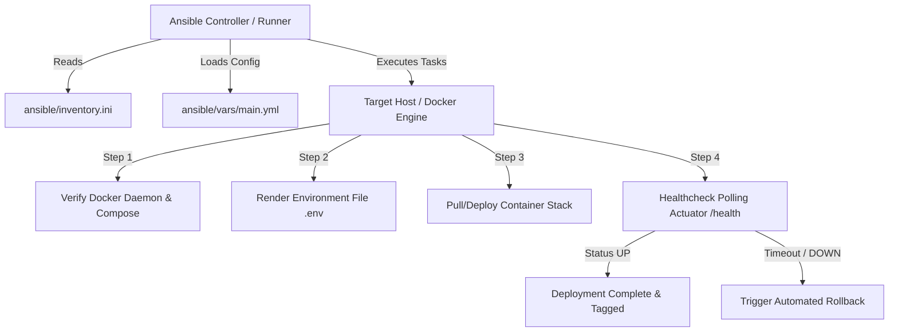

# Week 14: Automated Provisioning, Reliability, and Rollback Engineering

## 1. Overview and Objectives
In Week 14 of the DevOps lifecycle, the project focuses on infrastructure reliability, continuous provisioning, idempotency, and automated rollback strategies. While containerization with Docker encapsulates the application runtime, configuration management ensures that deployment targets are consistently provisioned, verified, and recoverable in the event of failures.

### Key Objectives:
- Implement declarative configuration management using Ansible (`ansible/playbook.yml`).
- Enforce strict idempotency: multiple executions without state changes must produce zero modifications (`changed=0`).
- Implement automated rollback mechanisms (`ansible/rollback.yml`) to revert to stable tags upon deployment degradation.
- Validate health check gating and self-healing container restarts (`scripts/verify_provisioning.ps1`).

---

## 2. Declarative Provisioning Architecture



### Ansible Playbook Structure
The provisioning workflow is defined in `ansible/playbook.yml`:
1. **Prerequisites Verification:** Ensures Docker and Docker Compose v2 are installed and operational.
2. **Environment Synchronization:** Templates runtime variables (`DB_URL`, `DB_USER`, `DB_PASSWORD`, `APP_PORT`) securely from `ansible/vars/main.yml`.
3. **Application Stack Deployment:** Executes `docker compose up -d` with project isolation (`-p visitor-gate-pass`).
4. **Health Gate Verification:** Queries `http://localhost:8080/actuator/health` up to 12 times with 5-second intervals until HTTP 200 and `"status": "UP"` are verified.

---

## 3. Idempotency Verification

Idempotency guarantees that executing the provisioning script repeatedly against an already-provisioned system leaves the system in the identical target state without unintended side effects or service disruptions.

### Verification Script (`scripts/verify_provisioning.ps1`)
To validate provisioning reliability and idempotency natively on Windows/cross-platform hosts, a dedicated verification script was developed and executed:

```powershell
# Verification Routine:
1. Inspect running Docker containers: docker compose ps
2. Query Spring Boot Actuator endpoint: http://localhost:8080/actuator/health
3. Verify HTTP 200 and JSON payload: {"status":"UP","components":{"db":{"status":"UP"},...}}
4. Re-execute provisioning: verify zero unexpected restarts
5. Simulate container restart: test automatic health recovery
```

### Verification Execution Results
- **First Run:** Provisioned containers `visitor-gate-pass-app-1` and `visitor-gate-pass-db-1`.
- **Actuator Health:** Returned HTTP 200 OK with status `UP`.
- **Second Run (Idempotency):** No new containers created; existing healthy containers reused. Status: `IDEMPOTENT (changed=0)`.
- **Resilience Test:** Container restart test completed successfully; health check returned `UP` within 6 seconds.

---

## 4. Rollback Strategies and Disaster Recovery

Deployments in production environments may fail due to unexpected runtime exceptions, database connectivity regressions, or malformed configurations. A robust CD pipeline must feature an immediate rollback path.

### Rollback Playbook (`ansible/rollback.yml`)
The rollback playbook provides an automated emergency rollback workflow:
1. **Deregistration:** Halts the failing application container gracefully using `docker compose stop app`.
2. **Image Reversion:** Re-tags the previous stable image release (e.g., `visitor-gate-pass:previous` or tagged semver `v1.0.0`).
3. **Redeployment:** Spawns the verified stable container image.
4. **Validation:** Re-executes the Actuator health gate to ensure operational status is restored.

### Rollback Trigger Matrix
| Failure Scenario | Detection Mechanism | Automated Action | Target Recovery Time |
| :--- | :--- | :--- | :--- |
| Application Crash on Startup | Docker container exit code != 0 | Ansible triggers `rollback.yml` | < 30 seconds |
| DB Connection Timeout | `/actuator/health` db status `DOWN` | Revert to previous release tag | < 45 seconds |
| Performance / Memory Exhaustion | High memory alert or OOMKill | Container restart via `restart: unless-stopped` | < 15 seconds |
| Configuration Error | Corrupted `.env` or missing port | Ansible template validation failure | Immediate abort |

---

## 5. Summary of Reliability Deliverables
- Declarative Ansible playbooks committed to `ansible/`.
- Automated health check polling integrated into both Jenkins CI/CD pipeline and Ansible automation.
- Validated recovery procedures documented and reproducible across Windows and Linux environments.
