# Project Presentation: Automated Residential Visitor Gate-Pass System
## 15-Week End-to-End DevOps Capstone Project

---

### Slide 1: Title Slide
# Automated Residential Visitor Gate-Pass System
### A Production-Grade Full-Stack & DevOps Capstone Implementation
- **Student / Engineer:** DevOps Engineering Team
- **Curriculum:** 15-Week End-to-End DevOps Lifecycle
- **Release Version:** `v1.0.0`
- **Stack:** Java 21 LTS | Spring Boot 3 | MySQL 8 | Docker | Jenkins | Selenium | Ansible

> **Speaker Notes:** Welcome everyone. Today we are presenting the Automated Residential Visitor Gate-Pass System, an end-to-end full-stack and DevOps capstone project developed across a structured 15-week engineering curriculum.

---

### Slide 2: The Problem
### Challenges in Conventional Residential Security
- **Physical Register Books:** Illegible handwriting, missing pages, and zero searchability.
- **Privacy & Security Risks:** Phone numbers and visitor logs exposed to public view in open logs.
- **Resident Bottlenecks:** Guards must manually phone residents for approvals, causing gate traffic jams.
- **Operational Drift:** Inconsistent local deployments, database connection race conditions, and lack of rollback safety.

> **Speaker Notes:** Manual visitor books are insecure, inefficient, and impossible to audit. Our project solves this through automated digital pass management combined with a fully automated DevOps delivery pipeline.

---

### Slide 3: The Solution
### Modern Cloud-Native Gate Pass Management
- **Role-Based Workflows:** Tailored interfaces for Administrators, Security Guards, and Residents.
- **Resident Pre-Registration:** Residents pre-approve guests with unique `GP-XXXX` pass codes.
- **Real-Time Guard Operations:** One-click Check-In, Check-Out, and walk-in registration.
- **Automated DevOps Assurance:** 100% automated build, test, containerization, and provisioning.

> **Speaker Notes:** The system digitizes the entire visitor lifecycle from pre-authorization to final departure, supported by self-healing container infrastructure.

---

### Slide 4: System Architecture
```
+--------------------------------------------------------------+
|                   Glassmorphic Web Frontend                  |
|    (Thymeleaf + Bootstrap 5.3 + Live Counters & Modals)      |
+------------------------------+-------------------------------+
                               | HTTP / REST
                               v
+--------------------------------------------------------------+
|              Spring Boot 3.2.4 Application Core              |
|   - Spring Security (BCrypt, RBAC, CSRF Protection)          |
|   - WebController (FSM Transition & Scope Enforcer)          |
|   - Spring Data JPA (Optimized Parameterized Queries)        |
|   - Spring Actuator (/actuator/health Monitoring)            |
+------------------------------+-------------------------------+
                               | JDBC Connection Pool
                               v
+--------------------------------------------------------------+
|              MySQL 8.0 Relational Persistence                |
|        (Health-Gated, Auto-Migrated, Persistent Volumes)     |
+--------------------------------------------------------------+
```

> **Speaker Notes:** We employ a robust layered architecture with strict separation between presentation, security, business logic, and data access.

---

### Slide 5: Pass State Machine (FSM)
```
          [Resident Pre-Registration]
                      |
                      v
                 +----------+
                 | APPROVED |
                 +----+-----+
                      |
[Guard Walk-in]       |
       |              |
       v              |
  +---------+         |
  | PENDING |---------+
  +----+----+         | (Guard Check-In)
       |              |
       v              v
  +----------+   +------------+
  | REJECTED |   | CHECKED_IN |
  +----------+   +-----+------+
                       |
                       v (Guard Check-Out)
                 +-------------+
                 | CHECKED_OUT |
                 +-------------+
```
- **Strict Server-Side Validation:** Transitions are validated in `VisitorPass.java` helper methods; invalid state transitions are rejected with HTTP 400.

> **Speaker Notes:** The core business entity follows a rigorous finite state machine preventing skips, duplicate check-ins, or post-checkout modifications.

---

### Slide 6: Technology Stack Matrix

| Layer | Technology | Version | Purpose |
| :--- | :--- | :--- | :--- |
| **Backend** | Java / Spring Boot | 21 LTS / 3.2.4 | High-performance, enterprise backend |
| **Security** | Spring Security | 6.2 | RBAC, BCrypt hashing, CSRF defense |
| **Database** | MySQL / H2 | 8.0 / In-memory | Relational persistence & fast test DB |
| **Containers**| Docker & Compose | 26.x / v2 | Isolated multi-service stack |
| **CI/CD** | Jenkins | 2.440+ | Automated 9-stage pipeline |
| **Testing** | Selenium / JUnit 5 | 4.19.1 / 5.10 | Headless Chrome UI & unit verification |
| **Config** | Ansible | Core | Idempotent provisioning & rollback |

> **Speaker Notes:** Every layer utilizes modern LTS and production-grade technologies, adhering to modern software engineering standards.

---

### Slide 7: 15-Week DevOps Lifecycle

```mermaid
gantt
    title 15-Week DevOps Engineering Roadmap
    dateFormat  W
    axisFormat W%W
    section Planning & Core
    Week 1: Problem Definition         :w1, 1, 1w
    Week 2: Agile Planning & Backlog   :w2, after w1, 1w
    Week 3: Architecture & Security    :w3, after w2, 1w
    section Development
    Week 4: Gitflow & Version Control  :w4, after w3, 1w
    Week 5: Feature Engineering & RBAC :w5, after w4, 1w
    Week 6: MVP Implementation         :w6, after w5, 1w
    section CI/CD & Testing
    Week 7: Jenkins Infrastructure     :w7, after w6, 1w
    Week 8: Pipeline-as-Code           :w8, after w7, 1w
    Week 9: Selenium E2E UI Testing    :w9, after w8, 1w
    Week 10: Continuous Test Gating    :w10, after w9, 1w
    section Cloud & Automation
    Week 11: Docker Containerization   :w11, after w10, 1w
    Week 12: Compose Orchestration     :w12, after w11, 1w
    Week 13: Ansible Configuration     :w13, after w12, 1w
    Week 14: Reliability & Rollback    :w14, after w13, 1w
    Week 15: Final Release v1.0.0      :w15, after w14, 1w
```



> **Speaker Notes:** We structured our project across 15 distinct weeks, transitioning from agile conceptualization to automated release engineering.

---

### Slide 8: Declarative CI/CD Pipeline (Jenkinsfile)
- **Stage 1: Checkout & Environment Init:** Checks out repository and verifies Java 21.
- **Stage 2: Compile & Unit Tests:** Runs `mvn test` (Fast fail gate).
- **Stage 3: Package & Test Gating:** Packages runnable fat JAR artifact.
- **Stage 4: Build Docker Image:** Builds Alpine-based image with non-root security.
- **Stage 5: Deploy Containers:** Deploys stack via `docker compose up -d`.
- **Stage 6: Health Gate & Smoke Test:** Polls `/actuator/health` until HTTP 200 `UP`.
- **Stage 7: E2E Browser Testing:** Executes headless Selenium user journey suite.
- **Stage 8: Archival & Teardown:** Archives Surefire reports and screenshots.

> **Speaker Notes:** Our Jenkins pipeline automates the complete path to production, failing immediately if any test fails or container health check times out.

---

### Slide 9: Automated Testing & Verification
### 18 / 18 Tests Passing (100% Pass Rate)
- **4 JPA Repository Tests:** Verified query derivation, search, and resident scoping.
- **9 Controller Tests:** Verified Spring Security filters, RBAC rules, and state machine transitions.
- **5 Selenium UI Tests:** Full browser user journeys in headless Chrome.
- **Visual Artifacts:** 5 full-page PNG screenshots saved in `screenshots/`.

> **Speaker Notes:** We maintain a complete test pyramid with unit tests, integration tests, and end-to-end browser journeys, all automated in CI.

---

### Slide 10: Docker Containerization & Health Gating
- **Multi-Stage & Minimal Footprint:** Alpine Linux base image with Java 21 JRE.
- **Non-Root Execution:** App runs under unprivileged `appuser` (UID 1001).
- **Zero Race Conditions:**
  ```yaml
  db:
    image: mysql:8.0
    healthcheck:
      test: ["CMD", "mysqladmin", "ping", "-h", "localhost", "-u", "root", "-prootpassword"]
      interval: 5s
      retries: 10
  app:
    depends_on:
      db:
        condition: service_healthy
  ```

> **Speaker Notes:** We resolved the classic database startup race condition by configuring Docker health check dependencies.

---

### Slide 11: Configuration Management with Ansible
- **Declarative Provisioning:** Defined in `ansible/playbook.yml`.
- **Idempotency Validated:** Re-running provisioning produces `changed=0` with zero service interruption.
- **Automated Rollback:** `ansible/rollback.yml` restores the previous stable container image if health checks degrade.
- **Automated Verification:** Verified via PowerShell and Bash test harnesses.

> **Speaker Notes:** Ansible provides predictable infrastructure state, idempotent operations, and automated rollback triggers.

---

### Slide 12: Security & Hardening Highlights
- **Authentication:** Spring Security with BCrypt password hashing.
- **Principle of Least Privilege:** Residents restricted strictly to their own flat passes.
- **Injection Immunization:** Spring Data JPA parameterized queries prevent SQLi.
- **Cross-Site Defense:** Thymeleaf entity escaping prevents XSS; synchronizer tokens prevent CSRF.
- **Zero Committed Secrets:** Decoupled environment files with `.env.example` template.

> **Speaker Notes:** Security was baked in from day one across both software code and container infrastructure.

---

### Slide 13: Live System Demonstration
1. **Resident Pre-Registration:** `resident1` logs in, pre-registers guest `David Miller` -> Generated code `GP-7421` (Status: `APPROVED`).
2. **Guard Look-up & Check-In:** `guard1` logs in, searches `David Miller`, clicks `Check-In` -> Status updates to `CHECKED_IN`.
3. **Walk-In Registration:** Guard registers delivery driver for `resident2` -> Status `PENDING` -> Guard approves & checks in.
4. **Departure Check-Out:** Guard clicks `Check-Out` -> Status transitions to `CHECKED_OUT` with immutable timestamp.

> **Speaker Notes:** The live workflow demonstrates seamless interaction between residents and security guards.

---

### Slide 14: Project Metrics & Deliverables
- **Codebase:** 100% complete, fully implemented Java & Thymeleaf codebase.
- **Test Suite:** 18 / 18 tests passing; Surefire reports & Selenium screenshots archived.
- **CI/CD Build:** Jenkins Build #7 status: `SUCCESS`.
- **Container Health:** Docker containers healthy; Actuator returns HTTP 200 `UP`.
- **Documentation:** Complete documentation across all 15 curriculum weeks.

> **Speaker Notes:** All 15 curriculum milestones have been completely realized and verified.

---

### Slide 15: Conclusion & Questions
### Automated Residential Visitor Gate-Pass System
- **Key Takeaway:** A production-ready, resilient, and secure application delivered through modern DevOps automation.
- **Repository Version:** `v1.0.0`
- **Thank you! We welcome your questions.**

> **Speaker Notes:** Thank you for your time. We are now open for viva voce questions.
